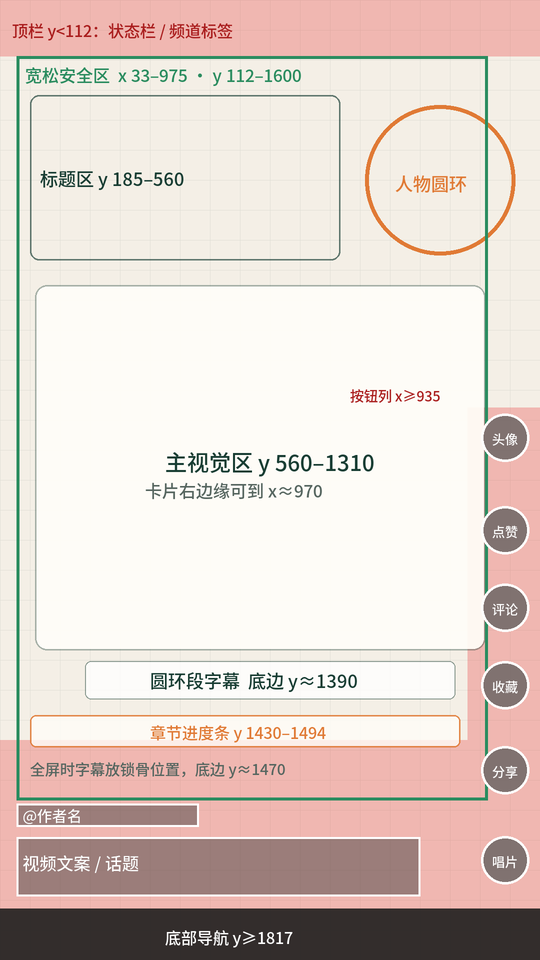

# koubo-video-edit · 竖版口播剪辑 Skill

把一段自己录的**竖版口播视频**，交给 AI 编程助手（Claude Code / Codex）一条龙剪成**可以直接发抖音、视频号、小红书的成片**。

- **粗剪**：转写和短窗复听，删掉口误、卡顿、重说；按实测语速自动调速（音调不变），以语句流畅为准。
- **讲解动画（B-roll）**：用代码生成（Remotion），米白纸面风格。讲解时人物缩进右上角圆环，总结和号召时人物全屏。每段换不同的转场和比喻动画。
- **开头钩子**：第 0 帧就是完整封面，前 6 秒卡点做道具动画，配人物推近和冲击音效。
- **音效**：每条视频重新程序化合成（无版权风险）。一类动作固定一种声音，同一个声音不连续出现，电平压在人声之下。
- **字幕**：居中单行，按词边界智能断句，关键词标红。人物全屏时字幕自动下移到锁骨位置，不挡脸。
- **抖音安全区**：按手机端实测的界面遮挡区排版，并提供叠图检查。
- **不加滤镜**：人物全屏时保持原片色彩，用 BT.709 全链路输出，最后自动比对颜色。
- **自检后交付**：完整解码、黑帧、响度（-16 LUFS）、重新转写比对、全屏字幕与下巴距离、安全区叠图，最后生成剪辑说明。



## 环境要求

| 依赖 | 说明 |
| --- | --- |
| FFmpeg / ffprobe | 需加入 PATH；有 NVIDIA 显卡时自动用 h264_nvenc |
| Python 3.10+ | `pip install -r requirements.txt`（Whisper 推荐模型 `large-v3-turbo`，首次运行会下载） |
| Node.js 22+ | 动效工程用 Remotion 4，在 `motion-template/` 里执行 `npm ci` |
| 磁盘 | node_modules 约 800 MB；一条 3 分钟 4K 成片的中间文件约 3 GB |

目前在 Windows 上实际跑通，macOS 和 Linux 理论上可用（脚本不依赖系统字体）。

## 安装

把整个仓库放到对应目录，文件夹名就是 skill 名：

```bash
# Claude Code
git clone https://github.com/limn123/koubo-video-edit ~/.claude/skills/koubo-video-edit

# Codex
git clone https://github.com/limn123/koubo-video-edit ~/.codex/skills/koubo-video-edit
```

然后安装依赖：

```bash
cd ~/.claude/skills/koubo-video-edit        # 或 ~/.codex/skills/koubo-video-edit
pip install -r requirements.txt
python scripts/fetch_fonts.py --fetch       # 预先下载字幕字体（也可以不跑，首次用到时自动下载）
```

## 使用

把口播视频（可以附上文案 `口播文案.txt` 和照片素材文件夹 `素材/`）放进一个文件夹，然后对助手说：

> 帮我剪辑这个视频：D:\videos\1105\口播视频.mov

或者直接调用 `/koubo-video-edit`。助手会按 `SKILL.md` 的流程走完全程。口播里听不清的数字会先问你，最后在视频所在目录的 `剪辑成果/` 下交付：

```
剪辑成果/
├── <名称>_成片.mp4          # 2160×3840 · 30fps · H.264/AAC · 已烧录字幕
├── <名称>_字幕.srt / .ass
├── 剪辑说明.md              # 删了什么、调速多少、分镜、音效对照、数据来源、自检结果
└── 工作素材/                # 转写、粗剪、分镜、联系表等中间文件
```

## 目录结构

```
SKILL.md                 # 给 AI 的完整流程和默认规矩（核心）
agents/openai.yaml       # Codex 显示名
scripts/                 # 转写、粗剪调速、字幕、混音、合成、各项自检脚本
references/              # 粗剪规则、动画与版式、音效规范、字幕规范、验收清单、剪辑说明模板
motion-template/         # Remotion 动效工程模板（一条完整的示例工程，可直接编译）
assets/fonts/            # 字体（OFL 1.1）
```

## 改成你自己的风格

默认规矩写在 `SKILL.md` 开头，常见的改法：
- **背景和配色**：改 `motion-template/src/bg.tsx` 和 `src/engine/theme.ts`。
- **人物圆环的位置**：改 `theme.ts` 的 `PIP_CORNER`（右上或左上）。
- **安全区**：改 `theme.ts` 的 `SAFE` 和 `scripts/safearea_check.py`。
- **字幕位置**：改 `scripts/restyle_subs.py` 的 `--broll-y` / `--full-y`。
- **专有名词词库**：在 `references/` 加一份地名和品牌名清单，转写时用 `--terms` 带上。

## 致谢与许可

- 本项目以 MIT 许可发布，见 [LICENSE](LICENSE)。
- 部分脚本和规范改编自 LeaderAI「Lead-自媒体口播剪辑」（leaderai-media-toolkit 1.7.0，MIT），原许可见 [LICENSE.leaderai](LICENSE.leaderai)。
- 字体：IBM Plex Sans SC、得意黑 Smiley Sans、Noto Sans SC、Inter Tight，均为 SIL OFL 1.1，见 [assets/fonts/](assets/fonts/README.md)。
- 动效基于 [Remotion](https://www.remotion.dev/)，转写基于 [OpenAI Whisper](https://github.com/openai/whisper)。注意 Remotion 对公司商用有单独的许可要求，请按其官网条款使用。
